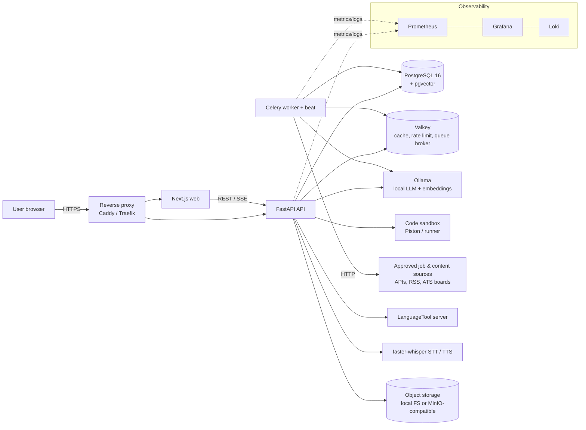
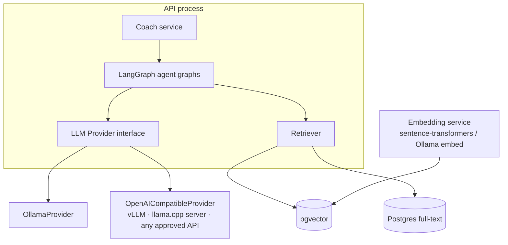
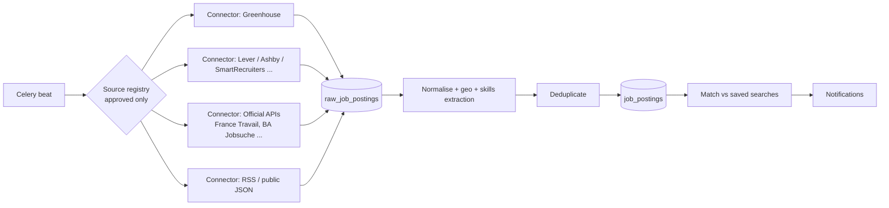

# 02 — System Architecture

## 1. Architectural style: modular monolith

One backend codebase (FastAPI) with **strict module boundaries**, deployed as two processes (API + worker),
plus a Next.js frontend and a code-execution sandbox. Rationale:

| Option | Verdict |
|--------|---------|
| Microservices from day one | ❌ More infra, more RAM, more ops for a solo/small team on a zero budget |
| Modular monolith | ✅ One deploy, one DB, simple local dev; modules can be extracted later (Job Radar and Sandbox are the likely first candidates) |

Rules that keep it extractable:
- A module only touches **its own tables**; cross-module access goes through the other module's `service` interface or domain events.
- Domain events (`attempt.graded`, `job.ingested`, `question.published`) are published on an in-process bus and,
  for async consumers, on the task queue.

## 2. Context diagram



## 3. Frontend architecture (Next.js, App Router, TypeScript)

- **Rendering**: server components for catalogue / job listings (SEO-irrelevant but fast); client components for the
  test player, editor, coach chat, audio recorder.
- **Data access**: typed API client **generated from the FastAPI OpenAPI schema** (`openapi-typescript` + `openapi-fetch`)
  → no hand-written DTO drift. TanStack Query for caching/mutations on the client.
- **Streaming**: coach responses via Server-Sent Events (`text/event-stream`) from the API.
- **UI**: Tailwind CSS + shadcn/ui (Radix primitives, copied into repo, MIT), lucide icons, Recharts for charts,
  Monaco editor for code, wavesurfer.js for audio.
- **State**: server state in TanStack Query; local UI state with React state / Zustand where needed.
- **i18n**: `next-intl` (EN, FR).
- **Auth**: the browser holds an httpOnly, Secure, SameSite=Lax session cookie set by the API; Next.js middleware only checks presence for redirects; the API is the authority.
- **Feature folders**: `app/(modules)/tests`, `/challenges`, `/coach`, `/english`, `/jobs`, `/analytics` mirroring backend modules.

## 4. Backend architecture (FastAPI, Python 3.12)

Each module follows the same layering:

```
modules/<name>/
  api.py          # FastAPI router: HTTP only, validation via Pydantic schemas
  schemas.py      # Pydantic v2 request/response models
  service.py      # use cases / business logic (no HTTP, no SQL strings)
  repository.py   # SQLAlchemy 2.0 queries for this module's tables
  models.py       # SQLAlchemy ORM models
  events.py       # domain events emitted/handled
  tasks.py        # Celery tasks for this module
```

Modules: `auth`, `users`, `taxonomy`, `content` (questions, sources, imports, licences), `assessments` (tests, attempts,
grading), `challenges` (code + scenarios + sandbox client), `coach` (agents, sessions), `english`, `jobs`,
`analytics` (ratings, readiness, roadmap), `notifications`, `admin`.

Shared kernel (`core/`): config (pydantic-settings), DB session, security, logging (structlog JSON), OpenTelemetry,
error model (RFC 9457 problem+json), pagination, rate limiting, event bus, LLM provider abstraction (`core/llm`).

**Async**: FastAPI + SQLAlchemy async (asyncpg). CPU-heavy or slow work (imports, embeddings, ingestion, STT,
LLM batch generation) goes to the worker.

## 5. Background processing

- **Celery** with **Valkey** as broker/result backend; **Celery beat** for schedules.
- Queues separated by workload so a slow LLM job never blocks job alerts:

| Queue | Tasks | Concurrency |
|-------|-------|-------------|
| `default` | notifications, emails, small housekeeping | 4 |
| `ingest` | job source polling, normalisation, dedup | 2 |
| `content` | imports, licence checks, embeddings | 1–2 |
| `llm` | question generation, roadmap generation, batch evaluation | 1 (bounded by local model) |
| `media` | STT transcription, TTS generation, pronunciation scoring | 1 |

- Idempotent tasks (natural keys / upserts), retries with exponential backoff + jitter, dead-letter table `task_failures`.
- Per-source rate limits enforced by a token bucket in Valkey.
- Long tasks report progress to `import_jobs` / `ingestion_runs` rows, polled or pushed via SSE.

## 6. Authentication & authorization

- **MVP: built-in auth** in the API (no external IdP needed):
  - Email + password, hashed with **Argon2id** (argon2-cffi).
  - Server-side sessions stored in Valkey (opaque random ID in httpOnly cookie), 7-day sliding expiry, rotate on login/privilege change.
  - CSRF: SameSite=Lax cookie + double-submit token for state-changing requests.
  - Optional TOTP 2FA (pyotp), mandatory for `admin`.
  - Password reset / email verification only if SMTP configured; otherwise admin-issued invite links.
- **Later / optional**: OIDC login (GitHub, Google, or self-hosted **Keycloak**/**Authentik**) via Authlib — same session model after login.
- **Authorization**: RBAC (`guest/learner/contributor/reviewer/admin`) + ownership checks in services
  (users only read their own attempts, sessions, applications). Enforced with FastAPI dependencies, tested per endpoint.
- **API tokens** (personal access tokens, hashed) for CLI/automation, scoped and expiring.

## 7. AI architecture (summary — details in doc 06)



## 8. Job ingestion architecture (summary — details in doc 07)



## 9. Code execution sandbox

Untrusted code is the highest-risk component. Design:
- Separate service, **never** in the API container. Default: our own small runner that starts one container per run
  under the **gVisor (runsc)** runtime. **Piston** (MIT) is a faster start for local dev, but its container needs
  `--privileged`, so it is not used on public deployments.
- Per run: no network, read-only root FS, tmpfs workdir, non-root UID, seccomp, `pids` limit, CPU/memory/time limits,
  output size cap, container destroyed after run.
- API → sandbox over an internal network only; sandbox has no route to DB/Valkey.
- DevOps scenario validators (kubeconform, kube-linter, tflint, checkov, hadolint, actionlint, Trivy) run in a dedicated
  "tools" image under the same constraints.

## 10. Deployment views

| Environment | How | Target |
|-------------|-----|--------|
| Local dev | `docker compose up` (profiles: `core`, `ai`, `english`, `observability`) + hot reload | Laptop 16 GB RAM |
| Single server | Docker Compose + Caddy (auto TLS) on one VPS / home server; Ansible playbook to provision | 4 vCPU / 16 GB RAM (8 GB without local LLM) |
| Kubernetes | Helm chart; tested on **kind** in CI; k3s for real single-node clusters; ArgoCD optional | Any CNCF K8s |

Infrastructure code: **OpenTofu** (Terraform-compatible HCL) modules for VM provisioning, **Ansible** for OS hardening
and Docker install, **Helm** for K8s. Container images built in GitHub Actions, scanned with Trivy, signed with
cosign (keyless optional), pushed to GHCR (free for public repos).

## 11. Key decisions (lightweight ADR log)

| # | Decision | Why | Alternative kept open |
|---|----------|-----|----------------------|
| 1 | Modular monolith | Lowest cost & complexity | Extract Jobs/Sandbox later |
| 2 | SQLAlchemy 2 + Alembic (not Prisma) | Backend is Python; one ORM | — |
| 3 | pgvector instead of separate vector DB | One less service, transactional consistency, enough for < 5M vectors | Qdrant via `VectorStore` interface |
| 4 | Valkey instead of Redis | Redis ≥ 7.4 is RSAL/SSPL (Redis 8 adds AGPL option); Valkey is BSD-3, drop-in compatible | Redis 8 (AGPL) |
| 5 | OpenTofu instead of Terraform | Terraform is BUSL-1.1 (source-available, not OSI); OpenTofu is MPL-2.0 and HCL-compatible | Terraform CLI works on the same code |
| 6 | Ollama as default LLM runtime | Easiest local setup, OpenAI-compatible API, structured outputs | vLLM (GPU), llama.cpp server |
| 7 | Built-in auth first | No extra 1 GB RAM IdP for a single-user install | Keycloak/Authentik via OIDC |
| 8 | Postgres full-text search | No Elasticsearch/OpenSearch needed at this scale | Meilisearch (MIT) |
| 9 | Celery | Mature, BSD, scheduling + routing built in | Dramatiq / arq |
| 10 | Deterministic grading for closed questions | LLMs must not decide what is correct when a key exists | — |
