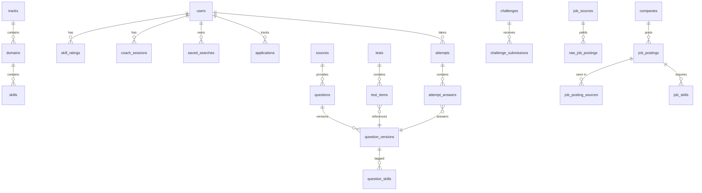

# 03 — Database Design

PostgreSQL 16 + `pgvector` + `pg_trgm` (fuzzy matching) + built-in full-text search.
Conventions: `uuid` PKs (UUIDv7 generated in app for index locality), `created_at`/`updated_at timestamptz`,
soft delete only where needed (`deleted_at`), enums as Postgres `text` + CHECK constraints (easier migrations),
Alembic migrations, one schema per module is **not** used (single `public` schema, table prefixes not needed —
ownership is documented below and enforced in code review).

## 1. Entity overview

## 2. Identity & users (module `auth`, `users`)

| Table | Key columns |
|-------|-------------|
| `users` | id, email (citext, unique), password_hash, display_name, role, locale, timezone, is_active, email_verified_at, totp_secret_enc, last_login_at |
| `user_profiles` | user_id PK/FK, target_roles text[], target_countries text[], years_experience, current_title, cv_text (optional, user-provided), cefr_levels jsonb, preferences jsonb |
| `api_tokens` | id, user_id, name, token_hash, scopes text[], expires_at, last_used_at |
| `audit_log` | id, actor_id, action, entity_type, entity_id, ip_hash, metadata jsonb, created_at (append-only) |

Sessions live in Valkey, not Postgres.

## 3. Taxonomy (module `taxonomy`)

| Table | Key columns |
|-------|-------------|
| `tracks` | id, slug, name, description |
| `domains` | id, track_id, slug, name, sort_order |
| `skills` | id, domain_id, slug, name, description, prerequisites uuid[] |
| `tags` | id, slug, name |
| `companies` | id, name, normalized_name, website, logo_url, ats_type, ats_board_token, country_codes text[] |

`skills` is many-to-many with tracks implicitly through domains; a skill can be reused by another track via `track_skills` (added when 2nd track arrives).

## 4. Content (module `content`)

| Table | Key columns |
|-------|-------------|
| `sources` | id, name, kind (`github_repo`/`oer_site`/`dataset`/`official_doc`/`internal`/`llm`), url, license_spdx, license_url, attribution_text, commercial_use_allowed bool, derivatives_allowed bool, share_alike bool, reviewed_by, reviewed_at, status (`approved`/`link_only`/`rejected`), notes |
| `questions` | id, current_version_id, provenance (`official_public`/`community_licensed`/`ai_generated`/`user_created`), source_id, source_ref (path/line/commit SHA), created_by, status (`draft`/`in_review`/`published`/`retired`), verification_status |
| `question_versions` | id, question_id, version, type, language, stem_md, options jsonb (`[{id, text_md}]`), answer_key jsonb (correct option ids / regex / numeric tolerance / test cases ref), explanation_md, distractor_explanations jsonb, rubric jsonb (open-ended), difficulty smallint, rating real (calibrated, default by difficulty), time_limit_s, content_hash, embedding vector(384), search_tsv tsvector, created_at |
| `question_skills` | question_version_id, skill_id, weight |
| `question_tags` | question_id, tag_id |
| `company_topics` | id, company_id, skill_id, description, evidence_url, provenance — *community-reported topics, never test content* |
| `import_jobs` | id, source_id, format, file_ref, status, stats jsonb (rows, valid, invalid, duplicates), report jsonb, created_by, started_at, finished_at |
| `review_items` | id, entity_type, entity_id, reason (`import`/`ai_generated`/`contribution`/`user_report`), status, reviewer_id, decision_note |
| `content_reports` | id, user_id, question_id, kind (`wrong_answer`/`licence`/`offensive`/`other`), message, status |

Indexes: `question_versions (content_hash)` unique per question; HNSW on `embedding` (cosine); GIN on `search_tsv`;
GIN `pg_trgm` on stem for near-duplicate detection.

## 5. Assessments (module `assessments`)

| Table | Key columns |
|-------|-------------|
| `tests` | id, title, description, owner_id (null = platform), visibility (`public`/`private`/`unlisted`), mode (`practice`/`exam`/`adaptive`), time_limit_s, per_question_time_s, shuffle bool, pass_score, generator_spec jsonb (for filter-based tests), status |
| `test_items` | test_id, position, question_version_id, points |
| `attempts` | id, user_id, test_id (nullable for ad-hoc/adaptive), mode, status (`in_progress`/`submitted`/`expired`/`abandoned`), started_at, deadline_at, submitted_at, score, max_score, client_meta jsonb |
| `attempt_answers` | id, attempt_id, question_version_id, position, response jsonb, is_correct bool null, score real, graded_by (`key`/`llm`/`sandbox`/`human`), llm_feedback jsonb, time_spent_ms, flagged bool, answered_at |
| `review_cards` | user_id, question_id, fsrs_state jsonb, due_at — spaced repetition of missed questions |

Server is authoritative for timing: `deadline_at` computed at start; answers after deadline rejected.

## 6. Challenges (module `challenges`)

| Table | Key columns |
|-------|-------------|
| `challenges` | id, slug, kind (`code`/`debug`/`dockerfile`/`k8s_manifest`/`k8s_troubleshoot`/`iac`/`cicd`/`bash`/`logic`), title, statement_md, languages text[], starter_code jsonb, difficulty, rating, provenance, source_id, limits jsonb (cpu_ms, mem_mb, timeout_s), validator jsonb, status |
| `challenge_tests` | id, challenge_id, is_hidden, input, expected_output, assertion jsonb, weight |
| `scenario_steps` | id, challenge_id, step_no, state jsonb (simulated cluster output), choices jsonb, correct_choice_ids, explanation_md |
| `challenge_submissions` | id, user_id, challenge_id, language, code (text, size-capped), status (`queued`/`running`/`passed`/`failed`/`error`/`timeout`), results jsonb, runtime_ms, memory_kb, created_at |
| `xp_events` | id, user_id, kind, amount, ref_type, ref_id, created_at |
| `badges` / `user_badges` | badge definitions / awards |
| `leaderboard_snapshots` | period, scope, entries jsonb (pseudonymous) |

## 7. Coach (module `coach`)

| Table | Key columns |
|-------|-------------|
| `coach_sessions` | id, user_id, kind (`question_help`/`mock_interview`/`writing`/`speaking`), persona, target_role, language, status, graph_state jsonb (LangGraph checkpoint ref), summary_md, scores jsonb, model_id, started_at, ended_at |
| `coach_messages` | id, session_id, role (`user`/`assistant`/`tool`/`system`), content_md, citations jsonb, audio_ref, tokens_in, tokens_out, latency_ms, created_at |
| `kb_documents` | id, source_id, title, url, license_spdx, language, content_hash, status |
| `kb_chunks` | id, document_id, chunk_no, text, embedding vector(384), search_tsv, metadata jsonb |
| `llm_eval_runs` | id, prompt_version, model_id, dataset, metrics jsonb, created_at — offline evaluation history |

LangGraph checkpoints stored with the official Postgres checkpointer (its own tables, `langgraph_*`).

## 8. English (module `english`)

| Table | Key columns |
|-------|-------------|
| `english_items` | id, section (`speaking`/`listening`/`reading`/`writing`/`grammar`/`vocabulary`/`professional`/`technical`/`interview`), cefr_level, title, content_md, audio_ref, transcript, questions jsonb, provenance, source_id, license_spdx |
| `vocab_entries` | id, lemma, pos, definition, example, cefr_level, domain (`general`/`devops`/`cloud`/`ai`/`interview`), source_id |
| `vocab_cards` | user_id, vocab_entry_id, fsrs_state jsonb, due_at |
| `english_attempts` | id, user_id, item_id, response_text, audio_ref, transcript, metrics jsonb (wpm, pauses, pronunciation per phoneme, grammar errors), feedback jsonb, score, created_at |
| `cefr_estimates` | user_id, skill, level, confidence, evidence_count, updated_at |

Audio files in object storage (local FS by default), retention configurable (default 30 days).

## 9. Jobs (module `jobs`)

| Table | Key columns |
|-------|-------------|
| `job_sources` | id, name, kind (`ats_greenhouse`/`ats_lever`/`ats_ashby`/`ats_smartrecruiters`/`ats_recruitee`/`ats_personio`/`official_api`/`aggregator_api`/`rss`), base_url, config jsonb (board token, country, query), terms_url, legal_status (`approved`/`pending_review`/`suspended`), attribution_required bool, attribution_text, rate_limit jsonb, poll_interval_min, credentials_ref (name of secret, never the value), last_success_at, consecutive_failures |
| `ingestion_runs` | id, source_id, started_at, finished_at, status, fetched, new, updated, errors jsonb |
| `raw_job_postings` | id, source_id, external_id, payload jsonb, payload_hash, fetched_at — retention 30 days |
| `job_postings` | id, company_id, title, normalized_title, category, seniority, description_md (sanitised), country_code, city, lat/lon, remote_type (`onsite`/`hybrid`/`remote`), remote_regions text[], employment_type, salary_min/max, salary_currency, salary_period, languages text[], visa_sponsorship bool null, posted_at, first_seen_at, last_seen_at, expires_at, status (`open`/`closed`), apply_url, dedup_key, embedding vector(384), search_tsv |
| `job_posting_sources` | job_posting_id, source_id, external_id, url, first_seen_at, last_seen_at — one job seen via N sources |
| `job_skills` | job_posting_id, skill_id null, raw_skill text, required bool |
| `company_watchlist` | user_id, company_id, created_at |
| `saved_searches` | id, user_id, name, filters jsonb, alert_mode (`off`/`instant`/`daily`/`weekly`), channels text[], last_notified_at |
| `job_matches` | user_id, job_posting_id, score, missing_skills text[], computed_at |
| `applications` | id, user_id, job_posting_id null, company_name, title, url, status, applied_at, next_step_at, notes_md, contacts jsonb |

Indexes: unique `(source_id, external_id)` on raw and link tables; GIN `search_tsv`; btree `(country_code, category, posted_at desc)`; HNSW on embedding; trigram on `normalized_title`.

## 10. Analytics & notifications

| Table | Key columns |
|-------|-------------|
| `skill_ratings` | user_id, skill_id, rating real (default 1000), rd real (uncertainty), attempts_count, last_attempt_at |
| `readiness_snapshots` | user_id, target_role, score, components jsonb, created_at |
| `roadmaps` | id, user_id, target_role, period_start, items jsonb ([{type, ref_id, reason, due}]), generated_by (`rules`/`rules+llm`), status |
| `daily_activity` | user_id, day, minutes, questions, challenges, english_items, xp — for heatmaps/streaks |
| `notifications` | id, user_id, kind, title, body, link, read_at, created_at |
| `push_subscriptions` | id, user_id, endpoint, p256dh, auth, created_at |
| `task_failures` | id, task_name, args_hash, error, traceback, created_at (dead-letter) |
| `feature_flags` | key, enabled, rules jsonb |

## 11. Data lifecycle

| Data | Retention |
|------|-----------|
| Raw job payloads | 30 days |
| Closed job postings | 180 days then archived/deleted |
| Audio recordings | 30 days (configurable, user can delete anytime) |
| Coach transcripts | Until user deletes / account deletion |
| Audit log | 1 year |
| Account deletion | Hard delete of personal data within 30 days; aggregated anonymous stats kept |
