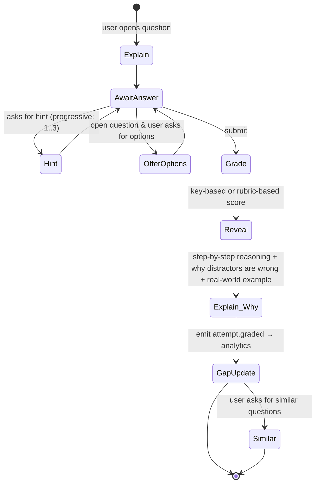

# 06 — AI Agents Design

> **As built (Phase 2, Prompt 3).** Code: `apps/api/src/careerpilot/modules/coach/` and `modules/kb/`.
>
> | Topic | Built | Difference from the original design below |
> |-------|-------|------------------------------------------|
> | Agents | 7 agents, one module each in `coach/agents/` (persona, topics, extra rubric criteria, open-problem brief, evaluation focus). A registry in `agents/__init__.py`; 6 interview personas. | Specialised agents replace "one coach + personas" |
> | Orchestration | A deterministic state machine in `coach/workflow.py`. Every model call is a background job (Celery `llm` queue) attached to a `pending` message, queued **after commit**, and the UI polls. | **No LangGraph.** The flows are short, linear and need no tool loop, so ~600 lines of explicit code are easier to test and audit than a graph framework (one less dependency). Revisit if agents gain tools. Responses are polled rather than streamed over SSE, because a local CPU model can exceed the web proxy timeout. |
> | Evaluation | `coach/evaluation.py`: keys grade closed questions; explanations that contradict the key are discarded; open answers get 0–5 per criterion (6 core + agent extras) and the overall score is computed in code; code is reasoned about, not executed; explanations are cached per question version. | — |
> | RAG | `kb_documents` / `kb_chunks` (Postgres full-text + pgvector HNSW, reciprocal rank fusion). Sources: curated notes in `content/kb/*.md` (CC BY 4.0), published question explanations, private user uploads. Citations must point to a retrieved passage, and a question never cites itself. | Embeddings via Ollama `nomic-embed-text` (768-d, Apache-2.0) instead of in-process sentence-transformers (no 2 GB torch dependency). Without embeddings, retrieval falls back to full text. No reranker yet. |
> | Personalisation | `coach/ratings.py`: Elo per topic, fed by Tests Hub submissions and coach answers (hints halve the weight; open answers count 0.5). Weakest topic first, target difficulty ≈ 65% expected success, recently seen questions excluded. `learner_profiles` holds role, seniority and interview length. | Elo instead of IRT (simpler, enough at this scale) |
> | Small CPU models | Ollama calls set `num_ctx`, `keep_alive`, `num_predict` (`LLM_MAX_TOKENS`) and `think: false`, and log one `llm_call` line (duration, load time, tokens, stop reason). AI jobs run one at a time (`worker-ai`). `COACH_COMPACT=true` scores only the 6 core criteria, asks for short feedback, drops concepts / real-world example / common mistakes, and uses 2 passages of 600 characters: on qwen3:1.7b at ~9 tokens/s an open-answer evaluation falls from ~75 s to roughly half. Compact explanations are cached with prompt version `coach-v1-compact` and regenerated in full mode. | — |
> | Not yet | Automated evaluation datasets (§6) against a real model, multilingual (FR) prompts, streaming, voice. | Planned |

## 1. Principles

1. **Local first** — default provider is Ollama; no paid API required. Any other provider must be explicitly enabled by the operator.
2. **LLMs explain, keys decide** — for closed questions correctness comes from the stored answer key or test cases;
   the LLM never overrides it. For open answers the LLM scores against an explicit rubric and returns structured JSON.
3. **Grounded, cited, humble** — answers use retrieved knowledge with citations; when retrieval is weak the agent says so.
4. **Structured outputs** — every agent step that feeds the app returns JSON validated by Pydantic (Ollama `format=<json schema>`);
   invalid output → one repair retry → graceful fallback message.
5. **Everything AI-generated is labelled** and goes through review before it can enter public catalogues.
6. **Small models are the target** — prompts, context sizes and graphs are designed for 4–8B models on CPU; larger models only improve quality.

## 2. LLM provider abstraction (`core/llm`)

```python
class LLMProvider(Protocol):
    name: str
    async def chat(self, messages: list[Message], *, model: str | None = None,
                   temperature: float = 0.2, max_tokens: int | None = None) -> ChatResult: ...
    def stream(self, messages: list[Message], **kw) -> AsyncIterator[ChatChunk]: ...
    async def structured(self, messages: list[Message], schema: type[BaseModel], **kw) -> BaseModel: ...
    async def health(self) -> ProviderHealth: ...

class EmbeddingProvider(Protocol):
    dim: int
    async def embed(self, texts: list[str]) -> list[list[float]]: ...
```

Implementations:
| Provider | Covers | Default |
|----------|--------|---------|
| `OllamaProvider` | Ollama native API (structured outputs, keep-alive, model pull) | ✅ |
| `OpenAICompatibleProvider` | vLLM, llama.cpp `llama-server`, LocalAI, LM Studio, and any approved hosted API with an OpenAI-compatible endpoint | optional |
| `SentenceTransformersEmbedder` | In-process embeddings (CPU) | ✅ embeddings |
| `OllamaEmbedder` | Embeddings via Ollama | alternative |

Model routing by **task profile**, configured in YAML, not code:

```yaml
llm:
  profiles:
    fast:      { provider: ollama, model: "qwen3:4b" }        # explain, hints, classification
    quality:   { provider: ollama, model: "qwen3:8b" }        # evaluation, mock interview, generation
    embedding: { provider: sentence_transformers, model: "intfloat/multilingual-e5-small", dim: 384 }  # multilingual: EN/FR/DE/IT/PT/AR job posts
```

Model tags above are examples; the operator chooses any model whose licence suits them (see stack doc §AI).
Prompt templates live in versioned files (`coach/prompts/*.jinja`, with `prompt_id@version`); every LLM call logs
prompt version, model, latency, token counts (never secrets; user content logging is configurable and off by default in production).

## 3. RAG architecture

```
Ingest:  source (licensed docs, curated notes, question explanations) → clean → chunk (≈400 tokens, 15% overlap, heading-aware)
         → embed → kb_chunks (pgvector HNSW + tsvector)
Query:   user question + question metadata (skills) → hybrid search (BM25-like ts_rank + vector cosine, RRF fusion)
         → filter by skill/domain/licence → optional rerank (bge-reranker-base, CPU) → top-k (4–6) → prompt with citations
```

Knowledge base content: our own curated explanations, question explanations, and external docs **only where the licence
allows storage** (e.g. Kubernetes docs CC BY 4.0, many CNCF projects Apache-2.0/CC BY). Otherwise: link only.
`langchain-text-splitters` and LangGraph are used; the rest is plain Python to keep dependencies small.

## 4. Agents

All conversational agents are **LangGraph** graphs (justified: multi-step state, branches, checkpointing to Postgres for
resumable sessions, human-in-the-loop for review). Single-shot tasks are plain functions.

### 4.1 Interview Coach (question help) — graph



Nodes:
- **Explain** — inputs: stem, skills, retrieved context; output `{reformulation, concepts[], what_is_asked}`; must not leak the key (output checked by string/option-id matching against key).
- **Hint** — graduated hints, each reveals more; hint usage recorded (reduces rating gain).
- **Grade** — MCQ/numeric/regex: deterministic. Open: `RubricScore{criteria:[{id,score,max,evidence}], total, confidence}`; if confidence low → mark "needs human review".
- **Reveal/Explain_Why** — receives the key as ground truth; output `{correct_answer, reasoning_steps[], distractors:[{option_id, why_wrong}], real_world_example, citations[]}`; validator ensures `correct_answer` matches key.
- **Similar** — calls Question Generator agent.

### 4.2 Question Generator + Validator (two-agent loop)

1. Generator: given skill, difficulty, type, and 2–3 exemplar questions → `QuestionDraft` JSON (stem, options, key, explanation, distractor explanations).
2. Validator (separate prompt, ideally the `quality` model): solves the question blind → if its answer ≠ draft key, or ambiguity detected → reject/repair (max 2 loops).
3. Dedup: embedding similarity > 0.92 with existing → discard.
4. Store as `provenance=ai_generated, verification_status=unverified`, visible to the requesting user with a badge; enters review queue for public use.
5. Statistical validation later: item discrimination from real attempts (point-biserial) → auto-flag bad items.

### 4.3 Mock Interviewer

- Personas: `technical` (track-specific), `system_design`, `behavioral_hr`, `english_interview`.
- Plan step: build an interview plan (N questions across target skills, adapted to user ratings and target role).
- Loop: ask → listen (text or Whisper transcript) → evaluate internally (rubric, hidden) → follow-up or move on → time management.
- End: report `{per_competency_scores, strengths[], improvements[], model_answers[], next_steps[]}`; scores feed analytics with low weight (LLM-graded evidence weighs less than key-graded).
- Never claims to reproduce a real company's interview; may use a company's *publicly documented* process as format inspiration with a disclaimer.

### 4.4 Writing Tutor (English)
LanguageTool (deterministic grammar/spelling) → LLM rubric (task achievement, coherence, vocabulary, tone/register for professional emails, CEFR estimate) → rewritten version + explanation of changes.

### 4.5 Speaking Coach (English)
Audio → faster-whisper (word timestamps) → fluency metrics (WPM, pause ratio, filler words) → for read-aloud: phoneme alignment vs reference (phonemizer + wav2vec2 phoneme model, optional) → LLM feedback on content & grammar of free speech → optional TTS model answer.

### 4.6 Skill Assessor / Adaptive engine (no LLM)
- Elo-style: `R_user,skill` and `R_question`; expected `E = 1/(1+10^((R_q−R_u)/400))`; update both with K-factor decaying with evidence count; hints and LLM-graded evidence reduce K.
- Next-question selection: maximise information (E≈0.6–0.7 for learning, ≈0.5 for assessment) with coverage constraints and exposure control.
- Spaced repetition: FSRS (`fsrs` Python package, MIT).

### 4.7 Job Matcher (mostly no LLM)
Skill extraction from job descriptions: dictionary/alias matching against our skills taxonomy (fast, deterministic) + optional small-LLM pass for unknown skills → embedding similarity profile↔job + required-skill coverage → `match_score` and `missing_skills`.

### 4.8 Roadmap Planner
Rules compute priorities (weakest skills × importance for target role × gaps in matched jobs); LLM only writes the human-readable weekly plan from the computed items (structured output), so the plan stays explainable.

## 5. Guardrails & safety

- Prompt-injection hygiene: retrieved text and job descriptions are wrapped as data, system prompt states they are untrusted; agents have **no tools that mutate state** besides explicit app-defined actions.
- Output validation: schema, key-consistency, length caps, profanity/PII filter on generated public content.
- Rate limiting and per-user concurrency (1 active generation) to protect a CPU-bound host.
- Timeouts + cancellation propagate to Ollama; fallbacks: "Coach unavailable, here is the stored explanation".
- Transparency: UI shows model name and "AI-generated, may contain errors" badge.

## 6. Evaluation

- `evals/` datasets: (a) 200 MCQs with keys → explanation must agree with key (target ≥ 98%); (b) open answers with human scores → rubric score correlation (target Spearman ≥ 0.7); (c) generator → validator acceptance rate & reviewer acceptance rate; (d) RAG → retrieval recall@5 on labelled queries.
- Run in CI on a small model (nightly, CPU) and locally before changing prompts/models; results stored in `llm_eval_runs`.
